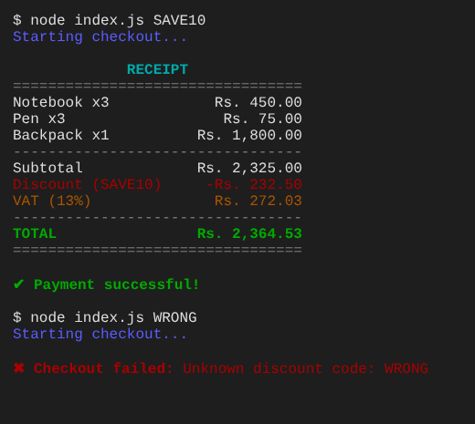

# 🛒 Shopping Cart CLI

A command-line shopping cart written in modern JavaScript (ES modules). Add products, apply a discount code and get a colour-coded receipt with **13% VAT** in Nepali rupees.

I built this to practise splitting a program into **modules**, then extended it with real billing rules and unit tests.



## Features

- **Cart management**: add and remove products; adding the same product again increases its quantity
- **Discount codes**: `SAVE10` (10% off) and `FLAT500` (Rs. 500 off, never below zero), not case-sensitive
- **13% VAT**, applied *after* the discount, as on a real bill
- **Accurate money maths**: all amounts are stored in paisa (whole numbers) to avoid floating-point errors
- **Coloured receipt** with aligned columns, using [chalk](https://github.com/chalk/chalk)
- **Input validation**: invalid products and unknown codes give clear error messages
- **15 unit tests** using Node's built-in test runner (no extra libraries)

## Getting started

Requires **Node.js 22 or newer**.

```bash
git clone https://github.com/<your-username>/shopping-cart-cli.git
cd shopping-cart-cli
npm install
```

### Run it

```bash
npm start                # checkout without a discount
npm start -- SAVE10      # 10% off
npm start -- FLAT500     # Rs. 500 off
npm start -- WRONG       # shows an error message
```

### Run the tests

```bash
npm test
```

## Project structure

```
shopping-cart-cli/
├── src/
│   ├── index.js       # entry point: builds a sample cart and runs checkout
│   ├── cart.js        # add / remove products, empty check
│   ├── pricing.js     # subtotal, discounts, VAT, totals, Rs. formatting
│   ├── receipt.js     # prints the coloured receipt
│   └── checkout.js    # ties it all together
├── tests/             # unit tests (node:test)
└── docs/              # screenshot for this README
```

How the modules depend on each other:

```
index.js ──► cart.js
         └─► checkout.js ──► cart.js
                         ├─► pricing.js
                         └─► receipt.js ──► pricing.js
```

## How the money maths works

In JavaScript, `0.1 + 0.2 === 0.30000000000000004`. To avoid errors like this, every price is stored as an integer number of **paisa** (Rs. 150 → `15000`). Calculations stay in whole numbers, VAT is rounded to the nearest paisa, and `formatRs()` converts back to rupees only when printing:

```js
formatRs(123450); // "Rs. 1,234.50"
```

## What I learned

- **ES modules vs CommonJS**: `import`/`export` vs `require`/`module.exports`, and why mixing them breaks when `"type": "module"` is set
- Structuring a program into small modules, each with a single job
- Handling money safely with integers
- Reading command-line arguments with `process.argv`
- Error handling with `throw` / `try...catch` and setting a non-zero exit code
- Writing unit tests with `node:test` and `node:assert`, including edge cases and mocking `console.log`

## Possible improvements

- Read the cart from a JSON file instead of hard-coding it
- An interactive mode where the user types products in
- Save receipts to a text file

## Author

**Dipesh Basnet** · BCA graduate

## License

[MIT](LICENSE)
